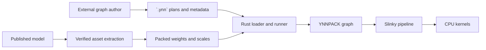

# YNNPACK model lab

A research and benchmarking lab to help the **XNNPACK/YNNPACK team understand
full-model performance gaps**. It provides runnable workloads, retained
measurements, kernel evidence, and bug reproductions for investigating YNNPACK
and Slinky execution. **There are no plans to ship this code for production.**

The runner is intended to support Gemma4 E2B, E4B, 12B and 31B, along with
multiple Qwen models. Shared execution, state, asset and measurement interfaces
serve these workloads; no model is the preferred entry point. The table below
separates current integrations from planned additions. Experiments examine
symbolic dimensions, runtime scalar bounds, state mutation, views, preparation
costs and memory use. FP32 vision classifiers provide additional backend workloads.

Use the [documentation index](docs/README.md) for workload guides and developer
references. The [measurement index](results/README.md) contains published
campaigns with their recorded runtime and configuration.

The canonical Rust runners load checked-in `.ynn` construction plans and invoke
native YNNPACK/Slinky graphs through a small C ABI. CMake builds `vision`,
`gemma4_e2b`, `gemma4_e4b`, and the generic `plan_fixture` harness. Profiles are
selected by model directory. Graph authors and compiler integration stay private;
building and running published plans needs no private compiler. Generated C++
model builders and JSON graph loading are retired. JSON remains the format for
metadata, manifests, fixture controls and measurements. See the
[artifact interface](docs/AUTHORING.md), [Rust runtime](docs/RUST_RUNTIME.md), and
[plan text reference](docs/PLAN_TEXT.md).

The Gemma plans record the `target_views` preparation policy: shared constant
deduplication and simplification, scheduled attention masks and eligible
reshape-to-view lowering. Each `model.json` records the policy and operation
counts. Native graph preparation and phase-specific packing still happen at
load time. The [design](docs/DESIGN.md) explains the state and execution contracts.

The [October 7 mobile baseline](results/2026-10-07-upstream-refresh/README.md)
uses the earlier C++ runner. Historical timing is not automatically a result
for the current checkout; measure the selected runtime, profile and device
when comparing performance.

## Models and workloads

Choose a model and numerical profile for the experiment, then follow its guide.
Each integrated model has its own assets, plans, fixtures and validation scope.

| Model / workload | Current support | Guide |
| --- | --- | --- |
| Gemma4 E2B | Published-bundle and direct safetensors profiles | [E2B](docs/E2B.md) |
| Gemma4 E4B | Published-bundle profile | [E4B](docs/E4B.md) |
| Gemma4 12B | Planned integration | — |
| Gemma4 31B | Planned integration | — |
| Qwen models | Model execution planned; Qwen3/Qwen3.5 tokenizer recipes available | [Tokenizers](docs/TOKENIZERS.md) |
| FP32 vision classifiers | ResNet18/34/50/101/152, ResNeXt50, Wide ResNet50 and MobileNetV2 | [Vision](docs/VISION.md) |

The LLM runners currently use teacher-forced benchmark requests. Integrated
status means a runnable workload with correctness checks; it does not establish
generation quality or performance on every device.
Opt-in [attention policies](docs/ATTENTION_EXPERIMENTS.md) and
[HF arithmetic profiles](docs/HF_GEMMA4.md) expose different numerical contracts.
Choose a complete matching package explicitly when comparing them.

## Build and test on Linux

Requirements: Git, Python 3.11+, [uv](https://docs.astral.sh/uv/getting-started/installation/),
CMake 3.20+, Ninja, a recent Clang toolchain,
and Rust/Cargo 1.87+ for the runners and optional native tokenizers.
The initial validation used Clang 22.1.8 and an x86_64 Linux host. Downloaded
dependency archives are checked against SHA-256 hashes in `dependencies.json`.

```sh
git clone https://github.com/snnn/ynnpack-model-lab.git
cd ynnpack-model-lab
uv sync --locked
uv run --locked python tools/bootstrap.py
uv run --locked cmake -S . -B build -G Ninja \
  -DCMAKE_BUILD_TYPE=Release \
  -DCMAKE_C_COMPILER=clang -DCMAKE_CXX_COMPILER=clang++
uv run --locked cmake --build build --parallel 8
uv run --locked ctest --test-dir build --output-on-failure
```

Python tooling dependencies are declared in `pyproject.toml` and pinned with
package hashes in `uv.lock`. uv installs them into the ignored `.venv/`.
Run CMake configuration through `uv run` so its Python tests use that environment.

Tests do not need model weights. They cover append/view behavior, multi-head
strides, partial chunks, invalid requests, packed FC arithmetic, embedding
unpacking, asset extraction, and Rust tokenizer/input references. Bootstrap
never changes a system installation. Use `tools/bootstrap.py --no-tokenizers`
and `-DLAB_ENABLE_TOKENIZERS=OFF` for a token-ID-only build. Rust remains required for the runners.
Dependencies live in the ignored `.deps/` directory. The repository and runtime
dependencies are public.

The [construction plan format](docs/GRAPH_PLANS.md) separates exporter checks,
typed load-time validation and dynamic invocation checks. Model metadata binds
phase hashes, assets and numerical profiles. Validate the selected package
on the target platform; earlier mobile and C++ measurements retain their
original scope.

The backend pins are XNNPACK/YNNPACK `0a66ebb5817f` and Slinky `a3eec6fcfe30`.
They retain upstream AVX-VNNI support and update x86 dot cost models and
thread-pool behavior. CPUinfo and tokenizer dependencies retain their pins.
Older records, including the October 7 mobile baseline, retain their original
revisions and validation scope. Existing checkouts should use a fresh dependency
and build directory; see [dependency update instructions](patches/README.md).

## Android: the same CMake build

Set `ANDROID_NDK` to your NDK installation and install the
`aarch64-linux-android` Rust standard library. The earlier native baseline used
NDK r28c (28.2.13676358), ARM64, API 28, static libc++. The current Rust/`.ynn`
E2B/E4B input frontend has text-to-TSV correctness checks on Linux and one
Android ARM64 device. These checks do not establish broader profile coverage
or performance.
SME/SME2 and FP8 remain disabled; DOTPROD and I8MM remain enabled.

```sh
rustup target add aarch64-linux-android
cmake -S . -B build-android -G Ninja \
  -DCMAKE_TOOLCHAIN_FILE="$ANDROID_NDK/build/cmake/android.toolchain.cmake" \
  -DANDROID_ABI=arm64-v8a -DANDROID_PLATFORM=android-28 \
  -DANDROID_STL=c++_static -DCMAKE_BUILD_TYPE=Release
cmake --build build-android --parallel 8

adb -s "$ANDROID_SERIAL" shell mkdir -p \
  /data/local/tmp/ynnpack-model-lab/tests
adb -s "$ANDROID_SERIAL" push build-android/rust_native_test \
  build-android/quantized_fc_test build-android/model_assets_test \
  /data/local/tmp/ynnpack-model-lab/
adb -s "$ANDROID_SERIAL" push tests/rust tests/generated \
  /data/local/tmp/ynnpack-model-lab/tests/
adb -s "$ANDROID_SERIAL" shell 'cd /data/local/tmp/ynnpack-model-lab && \
  ./rust_native_test tests/rust && \
  ./quantized_fc_test && ./model_assets_test'
```

Use the selected model's guide for asset preparation and device deployment.
Keep each model's binaries, plans and assets in its own device directory, check
available storage and memory, and use an explicit ADB serial. ADB may materialize
separate copies of hard-linked weights. Graph preparation can take tens of seconds;
report that cost separately from warm execution.

## Architecture and scope



In the current Gemma integrations, one prepared graph handles each phase.
The host supplies real query rows, position and capacity-backed buffers.
Symbolic expressions define append
positions and attention intervals. Cache updates copy only newly generated K/V;
the runner checks 9,216 appended bytes per token for E2B, 28,672 for E4B,
and zero view-copy callbacks.
Attention still reads history and can pack/dequantize it internally. This is
chunked attention, not online-softmax/FlashAttention.

- [Design and model extension](docs/DESIGN.md)
- [Standalone model artifacts](docs/AUTHORING.md)
- [Benchmarking](docs/BENCHMARKING.md)
- [Execution profiling](docs/PROFILING.md)
- [Measurements and validation by workload](results/README.md)
- [Dependency patches](patches/README.md)

## Licensing

Lab code is Apache-2.0; retained third-party notices and licenses are listed in
`NOTICE` and `third_party/`. Model weights have their own publisher's terms.
Graph-authoring sources and compiler integration are maintained separately and
are excluded from this repository. Generated plans and their standalone
runtime helpers retain the applicable notices and licenses.
