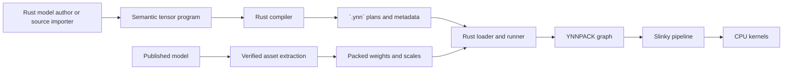

# YNNPACK model lab


Public Rust model authoring and lowering are described in [docs/COMPILER.md](docs/COMPILER.md).

A research and benchmarking lab to help the **XNNPACK/YNNPACK team understand
full-model performance gaps**. It provides runnable workloads, retained
measurements, kernel evidence, and bug reproductions for investigating YNNPACK
and Slinky execution. **There are no plans to ship this code for production.**

The runner is intended to support Gemma4 E2B, E4B, 12B and 31B, along with
multiple Qwen models. Shared execution, state, asset and measurement interfaces
serve these workloads; no model is the preferred entry point. The table below
separates current integrations from planned additions. Experiments examine
symbolic dimensions, runtime scalar bounds, state mutation, views, preparation
costs and memory use. FP32 vision classifiers provide additional backend workloads.

Use the [documentation index](docs/README.md) for workload guides and developer
references. [Open work](docs/worklogs/README.md) tracks unfinished performance,
validation and reproduction questions. The [measurement index](results/README.md)
separates completed campaigns by their actual runtime and configuration.

The canonical Rust runners load checked-in `.ynn` construction plans and invoke
native YNNPACK/Slinky graphs through a small C ABI. The
[general LLM runner](docs/GENERAL_RUNNER.md), `ynn-llm`, loads qualified Gemma4,
Qwen3 and Qwen3.5 packages using explicit metadata. CMake also builds `vision`,
the comparison controls `gemma4_e2b`, `gemma4_e4b`, `qwen3`, and `plan_fixture`. Profiles are
selected by model directory. The [Rust compiler and authoring API](docs/COMPILER.md)
build these plans from semantic tensor programs, with a standalone Qwen3 author
and checkpoint preparation tools. Source importers can supply the same program
contract. Generated C++
model builders and JSON graph loading are retired. JSON remains the format for
metadata, manifests, fixture controls and measurements. See the
[artifact interface](docs/AUTHORING.md), [Rust runtime](docs/RUST_RUNTIME.md), and
[plan text reference](docs/PLAN_TEXT.md).

The Gemma plans record the `target_views` preparation policy: shared constant
deduplication and simplification, scheduled attention masks and eligible
reshape-to-view lowering. Each `model.json` records the policy and operation
counts. Native graph preparation and phase-specific packing still happen at
load time. The [design](docs/DESIGN.md) explains the state and execution contracts.

The [measurement index](results/README.md) separates the current refresh from
older evidence retained for unresolved issues. Performance claims require a
matching runner, backend, model profile and device; archived timings do not
validate this checkout.

## Models and workloads

Choose a model and numerical profile for the experiment, then follow its guide.
Each integrated model has its own assets, plans, fixtures and validation scope.

| Model / workload | Current support | Guide |
| --- | --- | --- |
| Gemma4 E2B | Published-bundle and direct safetensors profiles | [E2B](docs/E2B.md) |
| Gemma4 E4B | Published-bundle profile | [E4B](docs/E4B.md) |
| Gemma4 12B | Planned integration | [Integration work](docs/worklogs/MODEL_INTEGRATIONS.md) |
| Gemma4 31B | Planned integration | [Integration work](docs/worklogs/MODEL_INTEGRATIONS.md) |
| Qwen3-0.6B / Qwen3-4B | Dynamic INT8 linears, FP32 attention/KV; CPU forced-token execution and drift checks | [Qwen3](docs/QWEN3.md) |
| Qwen3.5-4B | Validated FP32 text baseline; experimental INT8 / INT4-MLP profiles | [Qwen3.5](docs/QWEN35.md) |
| Other Qwen models | Planned execution | [Integration work](docs/worklogs/MODEL_INTEGRATIONS.md), [tokenizers](docs/TOKENIZERS.md) |
| FP32 vision classifiers | ResNet18/34/50/101/152, ResNeXt50, Wide ResNet50 and MobileNetV2 | [Vision](docs/VISION.md) |

The LLM runners currently use teacher-forced benchmark requests. Integrated
status means a runnable workload with recorded checks; device coverage and
model-quality evaluation have separate [gaps](docs/worklogs/VALIDATION_GAPS.md).
Opt-in [attention policies](docs/ATTENTION_EXPERIMENTS.md) and
[HF arithmetic profiles](docs/HF_GEMMA4.md) expose different numerical contracts.
Choose a complete matching package explicitly when comparing them.

## Build and test on Linux

Requirements: Git, Python 3.11+, [uv](https://docs.astral.sh/uv/getting-started/installation/),
CMake 3.20+, Ninja, a recent Clang toolchain,
and Rust/Cargo 1.97+ for the runners and optional native tokenizers.
The initial validation used Clang 22.1.8 and an x86_64 Linux host. Downloaded
dependency archives are checked against SHA-256 hashes in `dependencies.json`.

```sh
git clone https://github.com/snnn/ynnpack-model-lab.git
cd ynnpack-model-lab
uv sync --locked
uv run --locked python tools/bootstrap.py
uv run --locked cmake -S . -B build -G Ninja \
  -DCMAKE_BUILD_TYPE=Release \
  -DCMAKE_C_COMPILER=clang -DCMAKE_CXX_COMPILER=clang++
uv run --locked cmake --build build --parallel 8
uv run --locked ctest --test-dir build --output-on-failure
```

Python tooling dependencies are declared in `pyproject.toml` and pinned with
package hashes in `uv.lock`. uv installs them into the ignored `.venv/`.
Run CMake configuration through `uv run` so its Python tests use that environment.

Tests do not need model weights. They cover append/view behavior, multi-head
strides, partial chunks, invalid requests, packed FC arithmetic, embedding
unpacking, asset extraction, and Rust tokenizer/input references. Bootstrap
never changes a system installation. Use `tools/bootstrap.py --no-tokenizers`
and `-DLAB_ENABLE_TOKENIZERS=OFF` for a token-ID-only build. Rust remains required for the runners.
Dependencies live in the ignored `.deps/` directory. The repository and runtime
dependencies are public.

`runtime/ynnpack_capacity.h` provides explicit capacity migration between
prepared variants. Each variant owns both phases, compatible resource handles,
allocation lifetimes and unchanged fixed-state bindings. `ReserveCapacity`
copies initialized prefixes and retires old bindings only after the replacement
set is ready. The generic runner session also accepts a prepared larger session
through `reserve_capacity`; ordinary invocation never grows implicitly. The
exporter must supply equivalent programs at the different capacities. INT2/INT4
owners support multidimensional dense or padded row-major storage; parallel
append workers own complete bytes. Shared-owner requests remain exclusive.

The [construction plan format](docs/GRAPH_PLANS.md) separates exporter checks,
typed load-time validation and dynamic invocation checks. Model metadata binds
phase hashes, assets and numerical profiles.

The backend pins are XNNPACK/YNNPACK `0a66ebb5817f` and Slinky `a3eec6fcfe30`.
Use a fresh dependency/build directory when changing pins; see
[dependency update instructions](patches/README.md). Current validation and
remaining gaps are tracked in the [measurement index](results/README.md).

## Android: the same CMake build

Set `ANDROID_NDK` to your NDK installation and install the
`aarch64-linux-android` Rust standard library. The earlier native baseline used
NDK r28c (28.2.13676358), ARM64, API 28, static libc++. Current Rust/`.ynn` frontend correctness is checked separately from timing.
Broader device/profile coverage remains in the [validation tracker](docs/worklogs/VALIDATION_GAPS.md).
SME/SME2 and FP8 remain disabled; DOTPROD and I8MM remain enabled.

```sh
rustup target add aarch64-linux-android
cmake -S . -B build-android -G Ninja \
  -DCMAKE_TOOLCHAIN_FILE="$ANDROID_NDK/build/cmake/android.toolchain.cmake" \
  -DANDROID_ABI=arm64-v8a -DANDROID_PLATFORM=android-28 \
  -DANDROID_STL=c++_static -DCMAKE_BUILD_TYPE=Release
cmake --build build-android --parallel 8

adb -s "$ANDROID_SERIAL" shell mkdir -p \
  /data/local/tmp/ynnpack-model-lab/tests
adb -s "$ANDROID_SERIAL" push build-android/rust_native_test \
  build-android/quantized_fc_test build-android/model_assets_test \
  /data/local/tmp/ynnpack-model-lab/
adb -s "$ANDROID_SERIAL" push tests/rust tests/generated \
  /data/local/tmp/ynnpack-model-lab/tests/
adb -s "$ANDROID_SERIAL" shell 'cd /data/local/tmp/ynnpack-model-lab && \
  ./rust_native_test tests/rust && \
  ./quantized_fc_test && ./model_assets_test'
```

Use the selected model's guide for asset preparation and device deployment.
Keep each model's binaries, plans and assets in its own device directory, check
available storage and memory, and use an explicit ADB serial. ADB may materialize
separate copies of hard-linked weights. Graph preparation can take tens of seconds;
report that cost separately from warm execution.

## Architecture and scope



In the current Gemma integrations, one prepared graph handles each phase.
The host supplies real query rows, position and capacity-backed buffers.
Symbolic expressions define append
positions and attention intervals. Cache updates copy only newly generated K/V;
the runner checks 9,216 appended bytes per token for E2B, 28,672 for E4B,
and zero view-copy callbacks.
Attention still reads history and can pack/dequantize it internally. This is
chunked attention, not online-softmax/FlashAttention.

- [Design and model extension](docs/DESIGN.md)
- [Rust authoring and compiler](docs/COMPILER.md)
- [Standalone model artifacts](docs/AUTHORING.md)
- [Benchmarking](docs/BENCHMARKING.md)
- [Execution profiling](docs/PROFILING.md)
- [Measurements and validation by workload](results/README.md)
- [Dependency patches](patches/README.md)

[Model integration work](docs/worklogs/MODEL_INTEGRATIONS.md) tracks the planned
Gemma4 and Qwen additions. Shared backend investigations include prepared-weight
reuse and tiled online-softmax attention; see [open work](docs/worklogs/README.md).

## Licensing

Lab code is Apache-2.0; retained third-party notices and licenses are listed in
`NOTICE` and `third_party/`. Model weights have their own publisher's terms.
The Rust compiler, public model authors, asset tools, generated plans and
runtime helpers retain the applicable notices and licenses.

Qwen3.5-4B text-only FP32 packages use the shared Qwen runner; see
[the model guide](docs/QWEN35.md) for state, validation and execution contracts.
